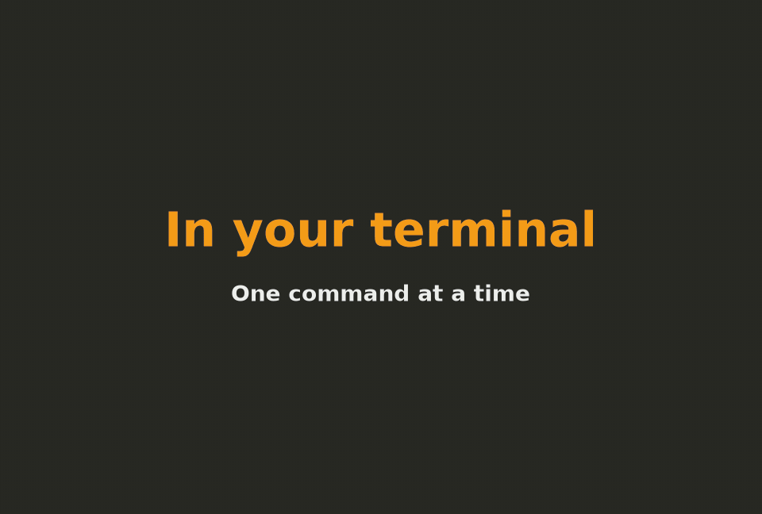
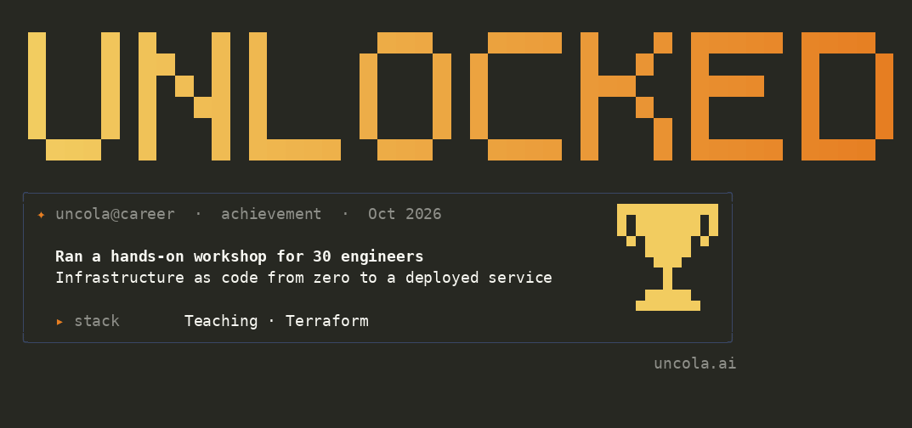

# Uncola CLI

<p align="center">
  
</p>

<p align="center">
  
</p>

<p align="center">Log your activities and 1:1s, track your wins and goals, and share your progress.<br><b>What did you get done today?</b></p>

Uncola CLI is your companion to [Uncola](https://uncola.ai). Manage your career without leaving the terminal, or add it to any agent and ask it to log your wins, check on your goals, or share your progress.

<br>

<table align="center"><tr><td>
  
</td></tr></table>

## Contents

- [Install](#install)
- [Quickstart](#quickstart)
- [Agents](#agents)
- [Uninstall](#uninstall)
- [Contributing](#contributing)
- [License](#license)

## Install

Needs [Node.js](https://nodejs.org) 22.12 or newer.

```bash
curl -fsSL https://uncola.ai/install.sh | bash
```

> **Note:** To download the script before running it, use the commands below:
>
> ```bash
> curl -fsSL -o install.sh https://uncola.ai/install.sh
> bash install.sh
> ```

This installs `uncola`, then asks about each agent it finds on your computer (Claude Code, Codex, Cursor, Kiro and Antigravity), one at a time: `Add the Uncola skill to Claude Code? [Y/n]`. Finally it asks `Sign in to Uncola now? [Y/n]`. Press Enter (or type `y`) to say yes, or `n` to skip.

The installer also adds `uncola` to your PATH in your shell's startup file. If the command isn't found right after installing, open a new terminal, or run the `export PATH=` line the installer printed.

## Quickstart

Sign in with the command below to get started:

```sh
uncola login
```

This opens your browser at Uncola's sign-in page. Sign in with your [Uncola](https://uncola.ai) account, then come back to the terminal.

Your sign-in is saved on this computer, in `~/.config/uncola/credentials.json`, which only you can read. `uncola` renews it as you use it, but after 30 days you need to run `uncola login` again. `uncola logout` signs you out and deletes it.

### CLI Usage

Some examples are shown below. To list all available commands, refer to [Getting help](#getting-help).

```sh
uncola log goal Get AWS certified --due 2026-12-15
uncola log activity Studied for the AWS exam --goal aws --time 2h
uncola log win Shipped the CLI to the first testers
uncola log 1on1 with Sarah: growth plan and Q1 priorities
uncola goal list
uncola goal progress aws 40
uncola feed
uncola recap
uncola brag 1
```

Everything after the type becomes the title, so quotes are optional.

`uncola brag` shows the entry's share card, then asks before it shares anything. For example:

<p align="center">
  
</p>

### CLI Usage - Interactive Shell

Run the `uncola` command to enter an interactive shell. It shows your dashboard, then a prompt where you type commands without `uncola` in front. Tab completes, `help` lists the commands, and `exit` or Ctrl-D quits.

```text
$ uncola
uncola> log act Studied for the AWS exam --goal aws --time 2h
uncola> goal progress aws 40
uncola> recap
uncola> exit
```

A type on its own, such as `uncola goal`, walks you through a new entry step by step.

### Getting help

`uncola help` prints all available commands. Every command has examples in its own help.

```sh
uncola help
uncola help log
```

`uncola help` prints:

```text
Usage: uncola [options] [command]

Log goals, activities, achievements and 1:1s to Uncola from the terminal.

Options:
  -V, --version                     output the version number
  --json                            print machine-readable JSON
  --env <name>                      environment: dev or prod (default:
                                    $UNCOLA_ENV or prod)
  -h, --help                        display help for command

Commands:
  home                              Dashboard: goal progress, latest entries and
                                    the main commands
  help [command...]                 Every command; help <command> for its
                                    options and examples
  log                               Save an entry in one line: log <type>
                                    <text>, e.g. log win Shipped the CLI
  feed|list [options] [type]        Your recent entries, newest first: feed
                                    [type], e.g. feed goal
  show|get <entry>                  Show one entry in full: show <# from the
                                    last list, or part of the title>
  goal|goals [options]              Add a goal step by step; goal list, goal
                                    progress
  activity|act [options]            Add an activity step by step; activity list
  achievement|ach [options]         Add an achievement step by step; achievement
                                    list
  1on1|1:1 [options]                Add a 1:1 note step by step; 1on1 list
  brag|share [options] [entry]      Share an entry publicly, like the megaphone
                                    in the app: brag <#>
  recap|highlights [options]        Your highlights for a period as a card:
                                    wins, goals, hours and skills
  delete|rm [options] <entries...>  Delete entries: delete <#> (also: rm)
  login|connect [options]           Sign in through your browser (also: connect,
                                    sign in)
  logout|disconnect                 Sign out and delete the stored tokens (also:
                                    disconnect, sign out)
  status|whoami                     Which account is signed in, and whether the
                                    API accepts it (also: whoami)

Types  goal · activity (act) · achievement (ach, win) · 1on1 (1:1, meeting)
Run "uncola help <command>" for a command's options and examples, e.g. uncola help log.
```

## Agents

The Uncola CLI can be added as a skill to any agent that supports [Agent Skills](https://agentskills.io), such as Claude Code, Kiro, Codex, Cursor and more.

### How the skill is installed

A skill is a folder of instructions the agent reads when a request matches. This one also carries its own copy of the CLI. When you run `curl -fsSL https://uncola.ai/install.sh | bash`, the installer looks for each of these agents on your computer and asks before adding the skill to each one it finds:

| Agent | Skill folder |
|---|---|
| Claude Code | `~/.claude/skills/uncola` |
| Codex, and the Antigravity CLI | `~/.agents/skills/uncola` |
| Cursor | `~/.cursor/skills/uncola` |
| Kiro | `~/.kiro/skills/uncola` |
| Antigravity | `~/.gemini/antigravity/skills/uncola` |

To add it to a specific agent without being asked, use `--agent` with one agent name (`claude`, `codex`, `cursor`, `kiro` or `antigravity`). Repeat it to add more than one:

```bash
curl -fsSL https://uncola.ai/install.sh | bash -s -- --agent claude
```

Installed an agent later? Run the installer again, and it asks about that agent too.

### How it works

1. Sign in once in a terminal with `uncola login`. Every agent uses that login.
2. Start a new session in your agent, so it picks up the skill.
3. Ask in plain words, like "log my win" or "how am I doing against my goals?". You don't need to mention Uncola.

The agent runs `uncola` for you and answers from your real entries. It may ask permission to run `uncola` (and, in Codex, for network access); allow it, because `uncola` only reads and writes your own Uncola account.

The skill adds guardrails to protect your Uncola records. For example:

- It logs only what you said, without adding details.
- It offers to update a goal's progress, rather than changing it on its own.
- Before sharing anything, it shows you the card and the text, and waits for your yes.
- It deletes an entry only after you confirm that exact entry.

### What you can ask

Below are some examples of working with an agent to interact with Uncola. You can ask a question or request an action in your own words.

**Log what you did**

- "I gave a talk on observability at the team offsite. Log it as a win."
- "Log 2 hours of AWS exam practice for my certification goal."
- "Log my 1:1 with Sarah: we agreed on my Q1 priorities, and I'll send her the plan by Friday."
- "Add a goal to get AWS certified by December 15."

**Check in**

- "How am I doing against my goals?"
- "What did I get done this week?"
- "Give me a recap of the last 90 days."
- "Move my certification goal to 60%."

**Share**

- "Brag about the certification."
- "Write a LinkedIn post about my summit talk."

## Uninstall

```bash
curl -fsSL https://uncola.ai/install.sh | bash -s -- --uninstall
```

This removes the `uncola` command, the skill from every agent, the line the installer added to your shell's startup file, and your sign-in and command history.

## Contributing

Bug fixes are welcome as pull requests. For anything bigger, open an issue first. See [CONTRIBUTING.md](CONTRIBUTING.md).

## License

[Apache 2.0](LICENSE)
